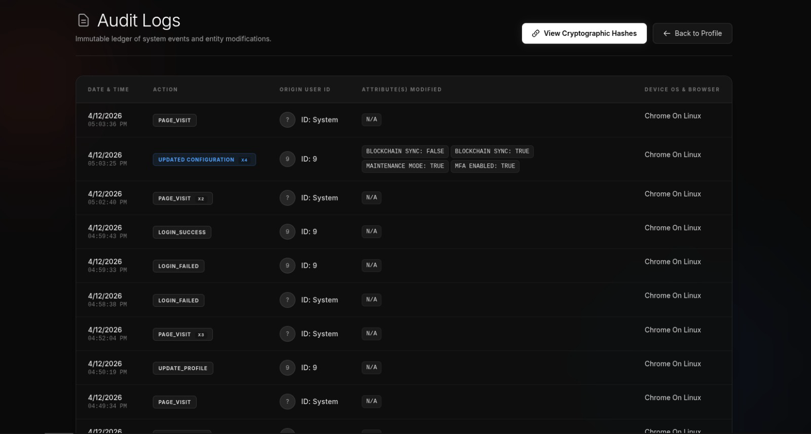
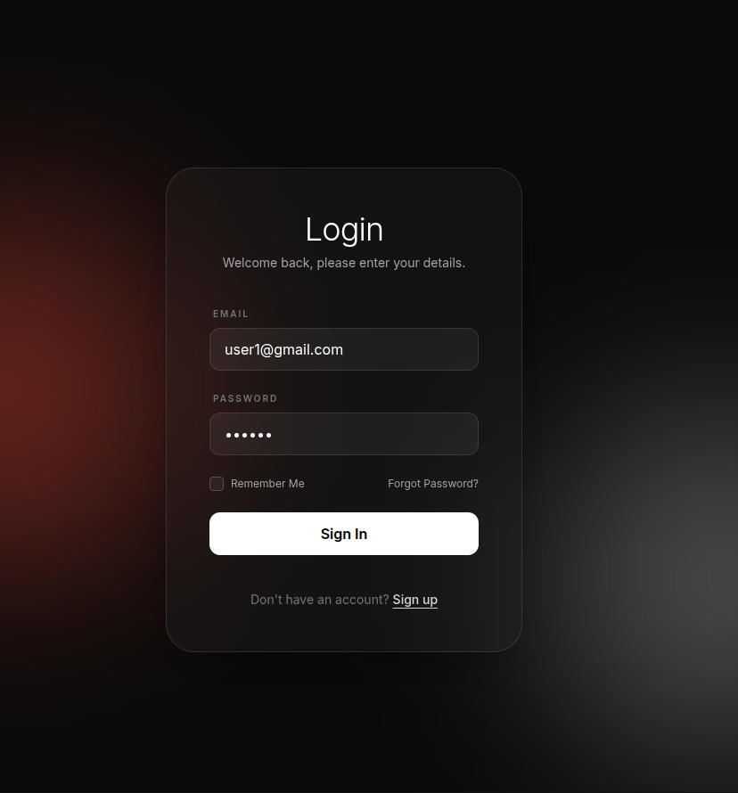
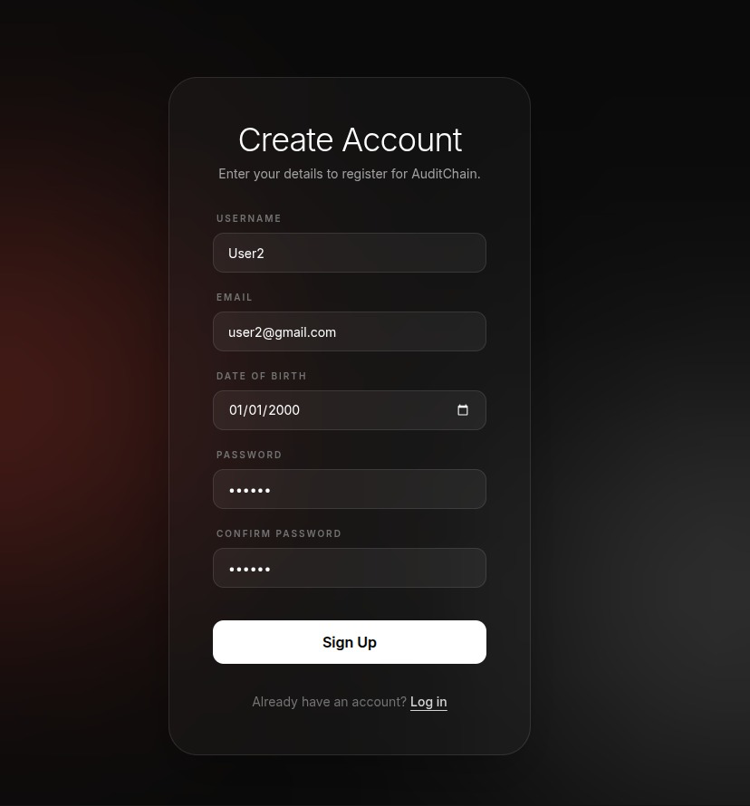
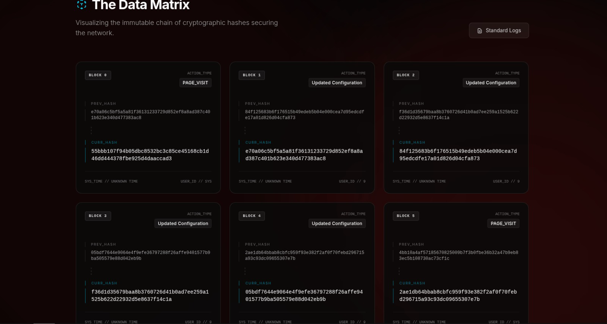
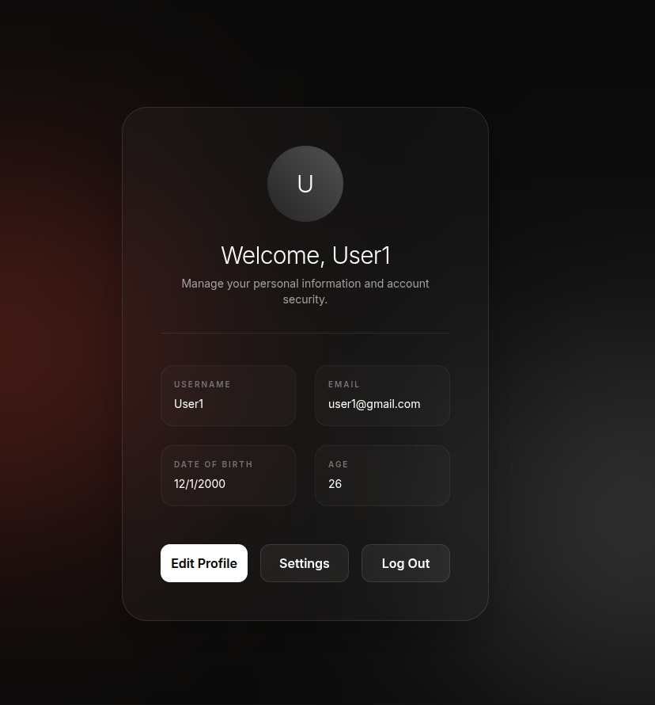
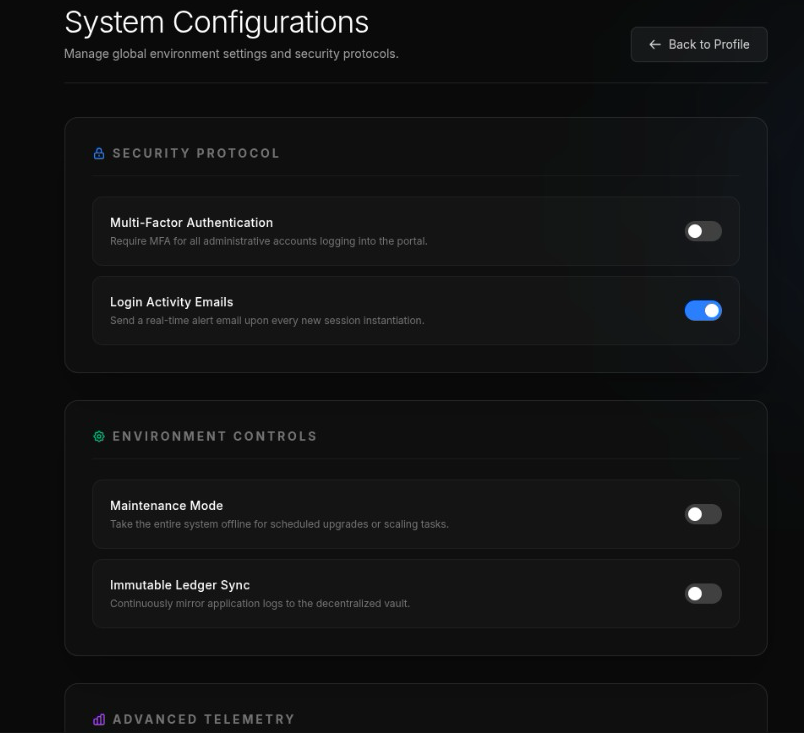
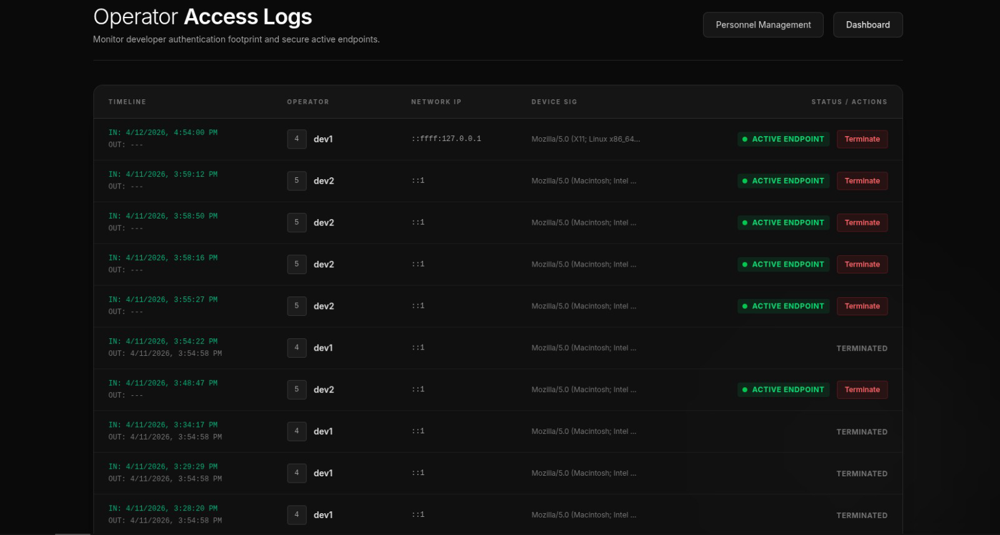
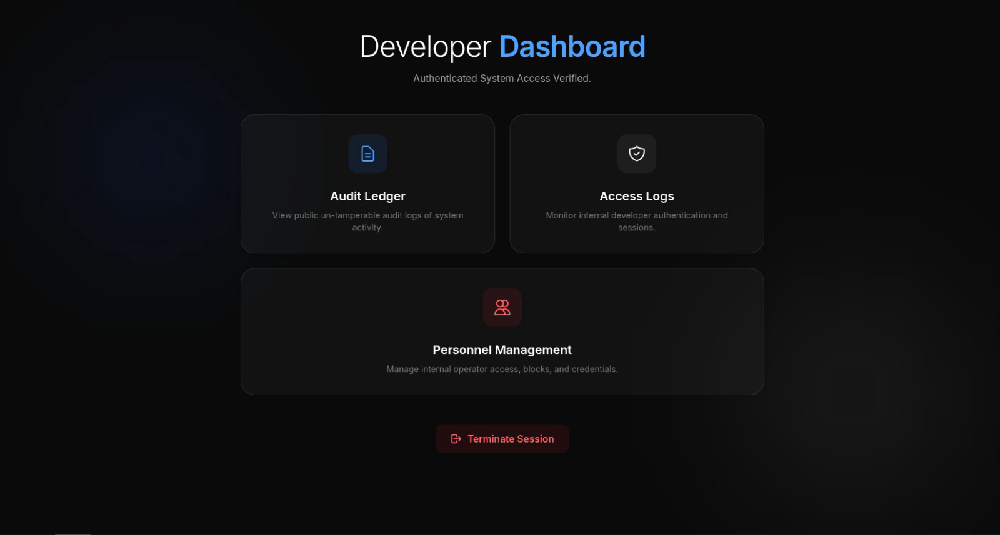

<div align="center">

# 🔗 AuditChain

**Tamper-evident audit logging for web apps — a hash-chained ledger, real-time dashboard, and brute-force protection, built into an Express + Next.js stack.**




</div>

---

## 📖 Overview

AuditChain pairs a sleek, animated **Next.js** frontend (dark, glassmorphic UI) with an **Express.js** backend and a custom **Audit SDK**. Every meaningful action in the app — signups, logins, profile edits, setting changes, even page visits — is intercepted automatically and written to an append-only ledger.

Each ledger entry stores the **SHA-256 hash of the previous entry**, forming a chain. If any record is edited or deleted, every hash after it stops matching, making tampering visible.

## ✨ Features

| | |
|---|---|
| 🔐 **Authentication** | Signup, login, logout, password reset, JWT in an `httpOnly` cookie, bcrypt-hashed passwords |
| 🧾 **Immutable Audit Ledger** | Every action logged with IP, user agent, status and a chained SHA-256 hash |
| ⛓️ **Hash Chain Viewer** | Visualise the chain from the `GENESIS` block onward and see each `previous_hash → current_hash` link |
| ⚡ **Real-time Updates** | The audit page refreshes live via Server-Sent Events (SSE) as new events arrive |
| 🛡️ **Brute-force Protection** | 3 failed logins triggers a 10-minute block; failed attempts and blocks are themselves logged |
| 🕵️ **Multi-device Attack Detection** | Logins for one account from too many IPs in a short window are flagged as `MULTI_DEVICE_ATTACK` |
| 👤 **Profile Management** | View and update account details |
| ⚙️ **System Configuration** | Toggle global settings (e.g. MFA, Maintenance Mode) — each change is written to the ledger |
| 🧑‍💻 **Developer Access Portal** | Separate service with developer login, admin panel, access logs, session kick and unblock tools |

## 📸 Screenshots

### Authentication
| Login | Sign up |
|:---:|:---:|
|  |  |

### Audit Ledger (real-time)


*Every action is captured automatically and appears live — no refresh needed.*

### Hash Chain


*Each block references the hash of the one before it, starting from `GENESIS`.*

### Profile & Settings
| Profile | System settings |
|:---:|:---:|
|  |  |

### Developer Access Portal
| Operator access logs | Developer admin |
|:---:|:---:|
|  |  |

*Monitor developer sign-ins by time, IP and device, and terminate any active session with one click.*

## 🏗️ Architecture

```
┌────────────────────┐   fetch (cookie)   ┌──────────────────────────────┐
│  Next.js Frontend  │ ─────────────────▶ │  Express API  (:3000)        │
│  (:3001)           │ ◀───────────────── │  ├─ Auth routes + JWT        │
│  middleware guards │                    │  └─ AuditChain SDK           │
│  protected routes  │ ◀── SSE events ─── │      ├─ request middleware   │
└────────────────────┘                    │      ├─ hash-chained logger  │
                                          │      └─ /audit dashboard     │
                                          └──────────────┬───────────────┘
                                                         │
                                              SQLite (users + audit.sqlite)

┌──────────────────────────────┐
│  Audit Access Service (:4000)│  Developer login, admin, access logs
└──────────────────────────────┘
```

### How the hash chain works

```js
previous_hash = lastLog ? lastLog.current_hash : "GENESIS";
current_hash  = sha256(JSON.stringify({ ...logData, previous_hash }));
```

Verifying integrity means recomputing each entry's hash and checking that it matches both its stored `current_hash` and the next entry's `previous_hash`.

## 📁 Project Structure

```
.
├── frontend/                       # Next.js app (App Router)
│   ├── middleware.ts               # Redirects unauthenticated users to /login
│   └── app/
│       ├── login/  signup/  forgot/
│       ├── profile/  update/  settings/
│       ├── audit/  hashes/         # Ledger + hash chain views
│       ├── dev/                    # Developer portal UI
│       └── lib/api.ts              # API helper
└── backend/express_auth_app/
    ├── app.js                      # API entry point (:3000)
    ├── controllers/  routes/  models/  middleware/
    ├── auditchainSDK/              # The audit SDK
    │   ├── middleware.js           # Request capture, login tracking, blocking
    │   ├── auditLogger.js          # Hash-chained logging + SSE events
    │   ├── hash.js                 # SHA-256 helper
    │   └── dashboard.js            # /audit JSON + /audit/events (SSE)
    └── audit-access-service/       # Developer access service (:4000)
```

## 🧰 Tech Stack

- **Frontend:** Next.js, React, TypeScript, Tailwind CSS, GSAP, Motion, UA-Parser
- **Backend:** Express.js, Sequelize ORM, SQLite3, JSON Web Tokens, bcryptjs
- **Real-time:** Server-Sent Events

## 🚀 Getting Started

### Prerequisites
- Node.js 18+ and npm

### 1. Start the backend

```bash
cd backend/express_auth_app
npm install
node app.js
```
The API starts on **http://localhost:3000** and creates the SQLite databases automatically.

### 2. Start the frontend

In a **second** terminal:

```bash
cd frontend
npm install
npm run dev -- -p 3001
```
Open **http://localhost:3001**.

> The backend's CORS is configured for `http://localhost:3001`, so run the frontend on that port.

### 3. (Optional) Start the developer access service

```bash
cd backend/express_auth_app/audit-access-service
npm install
node app.js
```
Runs on **http://localhost:4000**.

## 🧭 Usage

1. Create an account at `/signup`, then sign in at `/login`.
2. View or edit your details at `/profile` and `/update`.
3. Change global settings at `/settings`.
4. Open `/audit` to watch your actions appear in the ledger live.
5. Open `/hashes` to inspect the hash chain.
6. Try entering a wrong password 3 times to see the account block and the `LOGIN_BLOCKED` event logged.

## 🔌 API Reference

| Method | Endpoint | Auth | Description |
|---|---|:---:|---|
| POST | `/signup` | – | Create an account |
| POST | `/login` | – | Log in (sets `token` cookie) |
| POST | `/logout` | – | Clear the session cookie |
| POST | `/forgot` | – | Reset password |
| GET | `/profile` | ✅ | Get current user |
| POST | `/update` | ✅ | Update profile |
| POST | `/settings` | ✅ | Update system settings (logged to ledger) |
| POST | `/delete` | ✅ | Delete account |
| GET | `/audit` | – | Latest 100 audit entries (JSON) |
| GET | `/audit/events` | – | SSE stream of new log events |

## 🗺️ Roadmap

- [ ] Built-in "Verify chain integrity" button on the hash page
- [ ] Move secrets (JWT, session) to environment variables
- [ ] Persist the ledger across restarts
- [ ] Docker Compose setup
- [ ] Automated tests

## 📄 License

Released under the [ISC License](LICENSE).
